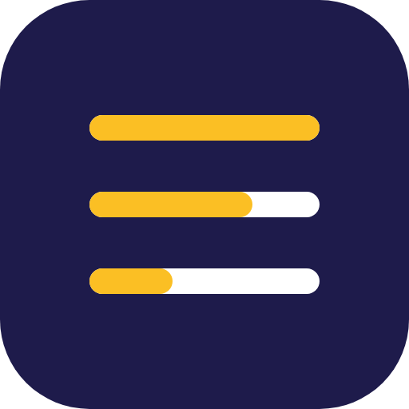

<p align="center">
  
</p>

<h1 align="center">maldonae-mods</h1>

<p align="center">Mods pour <a href="https://code.claude.com/docs">Claude Code</a> : de petites bandes au-dessus du champ de saisie pour suivre l'usage, voir la progression, enchaîner les actions, mieux écrire ses prompts, passer le relais avant que le contexte sature et contrôler la qualité avant chaque commit.</p>

Ce dépôt est une **marketplace de plugins Claude Code**. Ajoutez-la une fois, puis installez seulement les mods qui vous intéressent.

## Ajouter la marketplace

Dans une session Claude Code (terminal) :

```
/plugin marketplace add maldonae/mods-claude-code
```

Depuis un shell, sans session ouverte :

```
claude plugin marketplace add maldonae/mods-claude-code
```

## Les mods

| | Mod | Ce qu'il fait | Installation |
|---|---|---|---|
|  | [**cap**](plugins/cap) | Après chaque réponse, 3 actions suivantes cliquables ; un clic remplit le champ sans l'envoyer. | `/plugin install cap@maldonae-mods` |
|  | [**fil**](plugins/fil) | Barres de progression du tour en cours et des sous-agents. | `/plugin install fil@maldonae-mods` |
|  | [**jauge**](plugins/jauge) | Contexte utilisé, fenêtre 5 h, limite 7 jours, tokens du dernier tour. | `/plugin install jauge@maldonae-mods` |
|  | [**pen**](plugins/pen) | Bouton « Améliorer le prompt » : réécrit le brouillon en prompt clair et structuré, sans l'envoyer. | `/plugin install pen@maldonae-mods` |
|  | [**relay**](plugins/relay) | Fiche de reprise markdown et prompt prêt à coller dans une nouvelle session. | `/plugin install relay@maldonae-mods` |
|  | [**qa-guardian**](plugins/qa-guardian) | Avant chaque `git commit` de Claude : tests, lint, TODO, secrets, fichiers suspects ; bande verte, orange ou rouge, commit bloqué si secret ou test en échec. `/qa --report` écrit `qa-report.md`. | `/plugin install qa-guardian@maldonae-mods` |

Depuis un shell, remplacez `/plugin install` par `claude plugin install` (par exemple `claude plugin install pen@maldonae-mods`). Choisissez la portée **user** pour retrouver le mod dans toutes vos sessions.

Après l'installation, fermez la session Claude Code **et** VS Code, puis rouvrez-les ; si un mod n'apparaît toujours pas, redémarrez complètement le PC.

## Prérequis

- **Claude Code** en terminal, récent : ces plugins sont des *mods* (modules de hooks TypeScript chargés par Claude Code). Testés avec Claude Code **2.1.310** sous Windows 11.
- `git`, pour que Claude Code clone la marketplace. Dépôt public : aucun compte GitHub nécessaire. Sans clé SSH GitHub, si l'ajout échoue, définissez `CLAUDE_CODE_PLUGIN_PREFER_HTTPS=1`.
- **Aucune clé d'API, aucune variable d'environnement, aucun serveur MCP** : cap, pen et relay utilisent le modèle de votre session Claude Code.

## Comportements à connaître

| Mod | Appels au modèle | Fichiers | Processus lancés | Stockage local du mod |
|---|---|---|---|---|
| cap | 1 appel Haiku par tour principal (demande + fin de réponse) | aucun | aucun | non |
| fil | aucun | aucun | signal sonore en fin de tâche longue (`powershell` beep, `afplay` ou `paplay`) | état activé, progression des sessions ouvertes |
| jauge | aucun | aucun | aucun | non |
| pen | 1 appel Sonnet par clic sur le bouton | aucun | aucun | état activé |
| relay | 1 appel (copie de la conversation, sans outils) par relais confirmé | écrit `.claude/relay/relay-AAAA-MM-JJ-HHMM.md` dans le dossier courant, sans jamais écraser | aucun | seuil, état activé |
| qa-guardian | aucun | lit `package.json` ; écrit `qa-report.md` uniquement sur `/qa --report` ; ne lit jamais `.env`, `*.key`, `*.pem` | `git` (lecture : diff, status), scripts `test` et `lint` du projet via pnpm, yarn ou npm, avant chaque `git commit` lancé par Claude et sur `/qa` | non |

- Les appels au modèle consomment votre quota Claude Code ; aucune donnée n'est envoyée ailleurs.
- Rien n'est jamais envoyé à votre place : cap et pen **remplissent** le champ, vous validez avec Entrée.
- Garde-fous anti-injection dans le code de cap, pen et relay : caractères invisibles retirés ; suggestions ou réécritures rejetées si elles ajoutent une URL, une adresse, un bloc encodé ou une action sensible absents du texte d'origine ; secrets reconnaissables masqués dans les fiches de relay. Détails dans le README de chaque mod.
- Pensez à ajouter `.claude/relay/` au `.gitignore` de vos projets si les fiches ne doivent pas être versionnées.

### Hooks utilisés

Chaque mod déclare un seul module, `hooks/hooks.json` → `hooks/register.tsx`, qui s'abonne aux événements de session de Claude Code :

- cap : `session.start`, `command.run`, `turn.start`, `turn.complete`, `ui.render` (bande au-dessus du prompt)
- fil : `session.start`, `session.end`, `command.run`, `prompt.submit`, `turn.start`, `turn.complete`, `tool.call`, `agent.spawn`, `ui.render` (bande et panneau)
- jauge : `session.start`, `command.run`, `session.measure`, `tool.call` (relecture après l'appel, sans le modifier), `turn.complete`, `ui.render`
- pen : `session.start`, `command.run`, `ui.render`
- relay : `session.start`, `command.run`, `session.measure`, `ui.render`
- qa-guardian : `session.start`, `command.run`, `tool.call` (Bash, sur `git commit` uniquement), `ui.render`

Seul qa-guardian peut bloquer un appel d'outil : un `git commit` lancé par Claude, quand un secret ou un test en échec est détecté (désactivable avec `/qa off`). Aucun mod ne modifie un appel d'outil.

## Mettre à jour

Les mods sont versionnés : vous recevez une nouvelle version quand son numéro change.

```
/plugin marketplace update maldonae-mods
```

ou, depuis un shell : `claude plugin update pen@maldonae-mods`. Pour la mise à jour automatique : `/plugin` → **Marketplaces** → **maldonae-mods** → **Enable auto-update**.

## Désinstaller

```
/plugin uninstall pen@maldonae-mods
```

Pour retirer la marketplace et tous ses mods : `/plugin marketplace remove maldonae-mods` (ou `claude plugin marketplace remove maldonae-mods`).

## Développement

```powershell
npm install            # TypeScript et types Node, pour les tests Node
npm run quality        # copies de guard.ts identiques, tests Node, claude plugin validate
npm run test:mods      # tests du harnais de chaque mod (claude plugin test)
```

La vérification de types (par exemple `tsc -p plugins/pen`) fonctionne une fois le mod chargé par Claude Code, qui écrit ses types dans `plugins/pen/.claude-plugin/types/` (ignoré par git).

## Licence

[MIT](LICENSE) © 2026 Eric Maldonado, pour le code et les icônes. Aucun composant tiers n'est redistribué ; la provenance des visuels est détaillée dans [assets/README.md](assets/README.md).
